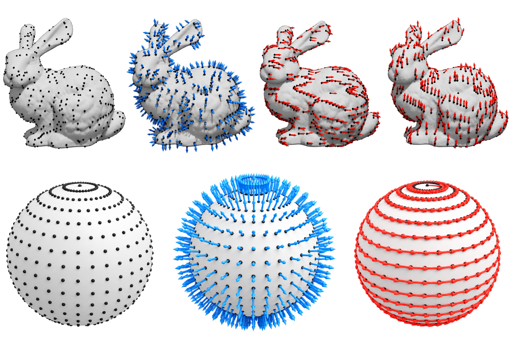

::: {.home-layout}

::: {.home-sidebar}

::: {.sidebar-profile}

::: {.sidebar-photo}
{fig-alt="Aritra Halder"}
:::

**Assistant Professor of Biostatistics**  
Department of Epidemiology and Biostatistics 
Dornsife School of Public Health  
Drexel University 
Phialdelphia, PA

**Adjunct Faculty** 
Department of Biomedical Sciences 
Drexel University 
Elkins Park, PA

**Faculty Affiliate** 
Urban Health Collaborative 
Drexel University 
Phialdelphia, PA

**Office** 
Nesbit 514, 3215 Market Street, Phialdelphia, PA 19132

**Email:**
aritra dot halder at drexel dot edu

<a href="https://scholar.google.com/citations?user=Pq1KTC8AAAAJ&hl=en" aria-label="Google Scholar" title="Google Scholar"><i class="bi bi-mortarboard-fill"></i></a>
<a href="https://github.com/arh926" aria-label="GitHub" title="GitHub"><i class="bi bi-github"></i></a>
<a href="https://www.linkedin.com/in/aritra-halder-07a137a0/" aria-label="LinkedIn" title="LinkedIn"><i class="bi bi-linkedin"></i></a>
<a href="cv.qmd">CV</a>

:::

::: {.sidebar-funding}

## Grant Funding

::: {.sidebar-grant}

::: {.sidebar-grant-logo}
{fig-alt="National Science Foundation"}
:::

::: {.sidebar-grant-content}

NATIONAL SCIENCE FOUNDATION

### Rates of Change and Boundary Assessment in Spatiotemporal Processes

**Lead PI**

NSF DMS 2515897/2515899/2515898 
2026–2029

:::

:::

::: {.sidebar-grant}

::: {.sidebar-grant-logo}
{fig-alt="National Institutes of Health"}
:::

::: {.sidebar-grant-content}

NATIONAL INSTITUTES OF HEALTH

### Cancer Risks from Unregulated Contaminants of Public Water Systems

**Co-Investigator**

R21 CA305033 
2026–2027

:::

:::

:::

:::

::: {.home-main}

::: {.home-hero}

Statistical methods for complex spatial,
spatiotemporal and geometric data.

My research program sits at the intersection of Bayesian spatial and spatiotemporal statistics, Gaussian processes, differential geometry, and scalable statistical computing. My current and future work develops this program along three interconnected directions: differential inference for spatial and spatiotemporal processes; scalable Gaussian process methodology; and statistical inference over non-Euclidean domains and Riemannian manifolds. These methodological developments find applications in public health, environmental science, ecology, spatial omics, and biomedical science.

If you are interested to work with me, please email me with a brief explanation of your research interests and a CV. 

<a href="publications.qmd" class="hero-button">Publications</a>

:::

::: {.home-education}

## Education

::: {.education-grid}

::: {.education-card}

2020

### Ph.D. in Statistics

**University of Connecticut**

Storrs, Connecticut, USA

:::

::: {.education-card}

2018

### M.S. in Statistics

**University of Connecticut**

Storrs, Connecticut,USA

:::

::: {.education-card}

2016

### M.Sc. in Applied Mathematics

**Chennai Mathematical Institute**

Chennai, India

:::

::: {.education-card}

2014

### B.Sc. in Statistics

**Presidency College, University of Calcutta**

Kolkata, India

:::

:::

:::

:::

:::
