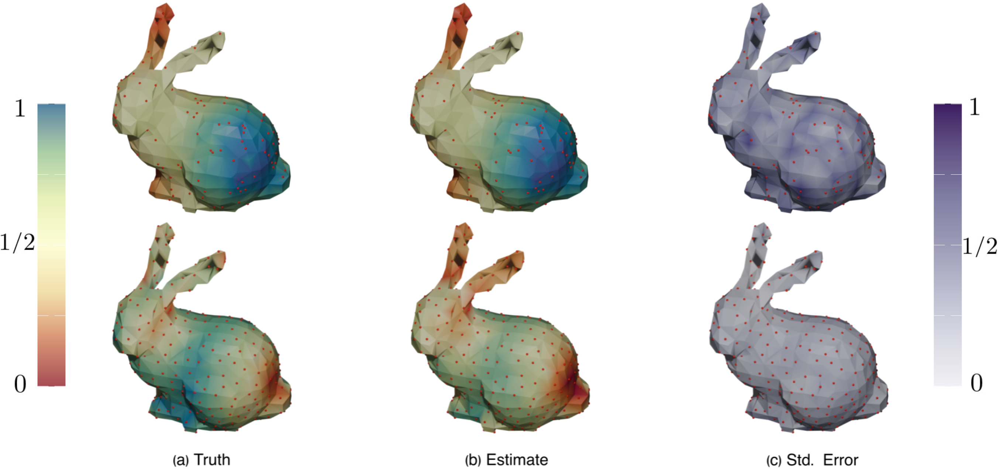
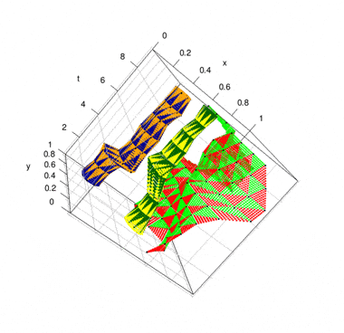
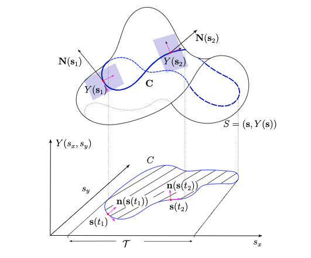
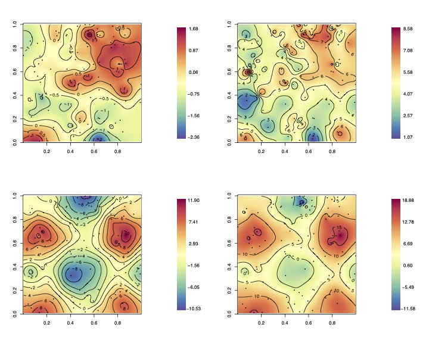

::: {.software-page}

::: {.software-intro}

# Software {.software-page-title}

I develop open-source software implementing methods from my research in spatial and spatiotemporal statistics, Bayesian computation, and statistical inference on manifolds.

:::

<!-- ============================================================
     FEATURED SOFTWARE
     ============================================================ -->

::: {.software-featured}

::: {.software-featured-label}
FEATURED PACKAGE
:::

## nimblewomble

### Bayesian wombling using `nimble`

`nimblewomble` provides tools for Bayesian wombling and boundary analysis using the `nimble` framework for hierarchical Bayesian modeling.

The package accompanies methodological work on Bayesian wombling and provides an accessible implementation for fitting models, conducting derivative-based inference, and identifying spatial boundaries.

::: {.software-meta}
**R** · **CRAN** · **Peer-reviewed software**
:::

::: {.software-links}
[CRAN](https://cran.r-project.org/web/packages/nimblewomble/index.html){.software-button .software-button-primary}
[GitHub](https://github.com/arh926/nimblewomble){.software-button}
[Paper](https://journal.r-project.org/articles/RJ-2026-026/){.software-button}
:::

:::

<!-- ============================================================
     RESEARCH SOFTWARE
     ============================================================ -->

## Research Software {.software-section-title}

::: {.software-project-grid}

::: {.software-project}

{.software-project-image}

01

### manifoldGPgrad

**Gaussian-process derivatives on manifolds**

Bayesian inference for spatial processes, intrinsic gradients, and directional derivatives over Riemannian manifolds.

R · Gaussian processes · Manifolds

[GitHub →](https://github.com/arh926/manifoldGPgrad){.software-project-link}

:::

::: {.software-project}

{.software-project-image}

02

### sptwombling

**Spatiotemporal wombling**

Bayesian differential inference and boundary analysis for spatiotemporal processes.

R · Spatiotemporal statistics · Wombling

[GitHub →](https://github.com/arh926/sptwombling){.software-project-link}

:::

::: {.software-project}

{.software-project-image}

03

### spWombling

**Spatial derivatives & wombling**

Bayesian inference for gradients, curvature processes, and curvilinear boundary analysis.

R · Spatial statistics · Curvature · Wombling

[GitHub →](https://github.com/arh926/spWombling){.software-project-link}

:::

::: {.software-project}

{.software-project-image}

04

### sptwdglm

**Spatial Tweedie models & variable selection**

Bayesian variable selection for double generalized linear Tweedie spatial process models.

R · Bayesian modeling · Spatial statistics

[GitHub →](https://github.com/arh926/sptwdglm){.software-project-link}

:::

:::
<!-- ============================================================
     DEVELOPMENT PHILOSOPHY
     ============================================================ -->

::: {.software-bottom}

## Research to Software

A recurring goal of my work is to translate new statistical methodology into software that can be used and extended by other researchers. These implementations also provide reproducible computational foundations for the methodological results presented in my publications.

[View publications →](publications.qmd)

:::

:::
---
